# Entity-relationship diagram

Generated from `backend/prisma/schema.prisma` (57 models). Each line reads "many `A` belong to one `B` via field". Regenerate after schema changes (see `backend/README.md`).

```mermaid
erDiagram
    AuditLog }o--o| User : "actor"
    BlockedUser }o--|| User : "blocked"
    BlockedUser }o--|| User : "blocker"
    Call }o--o| Conversation : "conversation"
    Call }o--|| User : "caller"
    CallEvent }o--|| User : "host"
    CallEventGuest }o--|| CallEvent : "event"
    CallEventGuest }o--|| User : "user"
    CallFavorite }o--|| User : "peer"
    CallFavorite }o--|| User : "user"
    CallParticipant }o--|| Call : "call"
    CallParticipant }o--|| User : "user"
    Channel }o--|| User : "owner"
    ChannelFollower }o--|| Channel : "channel"
    ChannelFollower }o--|| User : "user"
    ConversationMember }o--|| Conversation : "conversation"
    ConversationMember }o--|| User : "user"
    CoupleAppointment }o--|| CoupleConnection : "couple"
    CoupleAppointment }o--|| User : "createdBy"
    CoupleAvailability }o--|| CoupleConnection : "couple"
    CoupleAvailability }o--|| User : "user"
    CoupleCalendarEvent }o--o| CoupleConnection : "couple"
    CoupleCalendarEvent }o--|| User : "owner"
    CoupleConnection }o--o| Conversation : "conversation"
    CoupleConnection }o--|| User : "invitee"
    CoupleConnection }o--|| User : "inviter"
    CoupleGoal }o--|| CoupleConnection : "couple"
    CoupleGoal }o--|| User : "author"
    CoupleJournal }o--|| CoupleConnection : "couple"
    CoupleJournal }o--|| User : "author"
    CoupleMemory }o--o| CoupleConnection : "couple"
    CoupleMemory }o--|| User : "owner"
    Device }o--|| User : "user"
    Device }o--o| UserSession : "session"
    Follow }o--|| User : "followee"
    Follow }o--|| User : "follower"
    FollowRequest }o--|| User : "requester"
    FollowRequest }o--|| User : "target"
    Group }o--|| Conversation : "conversation"
    GroupMember }o--|| Group : "group"
    GroupMember }o--|| User : "user"
    LiveLocation }o--|| CoupleConnection : "couple"
    LiveLocation }o--|| User : "user"
    LocationSession }o--|| CoupleConnection : "couple"
    LocationSession }o--|| User : "user"
    Message }o--|| Conversation : "conversation"
    Message }o--o| Message : "forwardedFrom"
    Message }o--o| Message : "replyTo"
    Message }o--o| Story : "story"
    Message }o--o| User : "sender"
    MessageAttachment }o--|| Message : "message"
    MessageDeletion }o--|| Message : "message"
    MessageDeletion }o--|| User : "user"
    MessageReaction }o--|| Message : "message"
    MessageReaction }o--|| User : "user"
    MessageReadReceipt }o--|| Message : "message"
    MessageReadReceipt }o--|| User : "user"
    Notification }o--o| User : "actor"
    Notification }o--|| User : "user"
    OtpCode }o--o| User : "user"
    Post }o--|| User : "user"
    PostComment }o--|| Post : "post"
    PostComment }o--|| User : "user"
    PostLike }o--|| Post : "post"
    PostLike }o--|| User : "user"
    PostSave }o--|| Post : "post"
    PostSave }o--|| User : "user"
    PostTag }o--|| Post : "post"
    PostTag }o--|| User : "user"
    PrivateChat }o--|| Conversation : "conversation"
    PrivateChat }o--|| User : "user"
    RefreshToken }o--|| UserSession : "session"
    Report }o--o| User : "reportedUser"
    Report }o--o| User : "resolver"
    Report }o--|| User : "reporter"
    SavedPlace }o--|| User : "user"
    ScheduledCall }o--|| User : "peer"
    ScheduledCall }o--|| User : "user"
    StarredMessage }o--|| Message : "message"
    StarredMessage }o--|| User : "user"
    Story }o--|| User : "user"
    StoryDraft }o--|| User : "user"
    StoryHighlight }o--|| User : "user"
    StoryHighlightItem }o--|| StoryHighlight : "highlight"
    StoryReaction }o--|| Story : "story"
    StoryReaction }o--|| User : "user"
    StoryViewer }o--|| Story : "story"
    StoryViewer }o--|| User : "viewer"
    Streak }o--|| Conversation : "conversation"
    Streak }o--|| User : "userA"
    Streak }o--|| User : "userB"
    StreakEvent }o--|| Streak : "streak"
    StreakRun }o--|| Streak : "streak"
    SuggestionDismissal }o--|| User : "user"
    UserProfile }o--|| User : "user"
    UserSession }o--|| User : "user"
    UserSettings }o--|| User : "user"
```

## Models

- `User`
- `UserProfile`
- `UserSettings`
- `UserSession`
- `RefreshToken`
- `Device`
- `OtpCode`
- `Follow`
- `FollowRequest`
- `BlockedUser`
- `SuggestionDismissal`
- `Post`
- `PostLike`
- `PostSave`
- `PostComment`
- `PostTag`
- `Conversation`
- `ConversationMember`
- `Group`
- `GroupMember`
- `PrivateChat`
- `Message`
- `MessageAttachment`
- `MessageReaction`
- `MessageReadReceipt`
- `MessageDeletion`
- `StarredMessage`
- `Story`
- `StoryViewer`
- `StoryReaction`
- `StoryHighlight`
- `StoryHighlightItem`
- `StoryDraft`
- `CoupleConnection`
- `CoupleCalendarEvent`
- `CoupleMemory`
- `CoupleJournal`
- `CoupleGoal`
- `CoupleAppointment`
- `CoupleAvailability`
- `LocationSession`
- `LiveLocation`
- `Streak`
- `StreakEvent`
- `StreakRun`
- `Notification`
- `Call`
- `CallParticipant`
- `CallFavorite`
- `ScheduledCall`
- `CallEvent`
- `CallEventGuest`
- `SavedPlace`
- `Channel`
- `ChannelFollower`
- `Report`
- `AuditLog`
